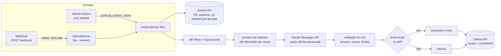

<div align="center">

# 🛡️ pr-sentinel

**Revisor de Pull Requests com IA (Claude), escrito em Go.**
Roda como GitHub Action reutilizável ou como serviço de webhook, com o mesmo núcleo.


<!-- TODO: substituir pelo GIF/screenshot real de um PR revisado (docs/demo.gif) -->


</div>

## O problema

Revisão de código é cara e irregular: PRs grandes ficam parados, o cansaço faz passar bugs óbvios e ninguém lembra de perguntar "quais testes estão faltando?". O pr-sentinel faz uma **primeira passada automática** em cada PR e deixa no próprio PR:

- um **resumo** do que mudou e o **nível de risco** geral;
- **achados** classificados por severidade (`info`, `warning`, `critical`) e categoria (`bug`, `security`, `performance`, `style`, `tests`), com comentários **inline** na linha certa;
- a lista de **testes que estão faltando**.

Ao enviar novos commits, o comentário de resumo é **atualizado** (não duplicado) e achados já comentados não são repetidos. A revisão sai em **português do Brasil** por padrão.

## Como funciona



Camadas (`internal/`): `config` (env + YAML) · `diff` (filtros/truncamento) · `claude` (cliente HTTP próprio) · `github` (cliente REST, eventos, HMAC) · `review` (prompt, validação, publicação) · `action` e `server` (os dois modos). O núcleo depende só de interfaces (`github.API`, `claude.Completer`), então tudo é testado com mocks e `httptest`.

## Instalação em 3 passos (GitHub Action)

**1. Guarde a chave** em *Settings → Secrets and variables → Actions* com o nome `ANTHROPIC_API_KEY`.

**2. Crie `.github/workflows/pr-review.yml`:**

```yaml
name: PR Review
on:
  pull_request:
    types: [opened, synchronize, reopened]

permissions:
  contents: read
  pull-requests: write

jobs:
  review:
    runs-on: ubuntu-latest
    steps:
      - uses: LeonardoBoni-018/pr-sentinel@main
        with:
          anthropic-api-key: ${{ secrets.ANTHROPIC_API_KEY }}
```

**3. (Opcional) Ajuste o comportamento** com um `.pr-sentinel.yml` na raiz do repositório:

```yaml
language: pt-BR          # idioma da revisão
min_severity: warning    # info | warning | critical
on_error: comment        # comment | silent | fail
ignore:                  # globs extras (suporta **)
  - "docs/**"
  - "**/*.snap"
instructions: |
  Somos um time Go. Priorize concorrência e tratamento de erros.
```

Pronto: abra um PR. Para pular um PR, use a label `skip-review`.

> **Forks:** PRs vindos de forks não recebem *secrets*, então a Action não consegue chamar a API. Não use `pull_request_target` com `actions/checkout` do código do PR — veja [Segurança](#segurança).

### Modo servidor (webhook)

```bash
export ANTHROPIC_API_KEY=...   GITHUB_TOKEN=...   WEBHOOK_SECRET=...
make run                       # escuta em :8080 (PR_SENTINEL_ADDR)
# ou: docker run -p 8080:8080 -e ANTHROPIC_API_KEY -e GITHUB_TOKEN -e WEBHOOK_SECRET pr-sentinel
```

No GitHub: *Settings → Webhooks → Add webhook* → `https://seu-host/webhook`, content type `application/json`, o mesmo `WEBHOOK_SECRET`, evento **Pull requests**. Saúde do serviço: `GET /healthz`.

## Configuração

Precedência: padrões → variáveis de ambiente → `.pr-sentinel.yml` (somente os campos de revisão).

| Variável de ambiente | Input da Action | `.pr-sentinel.yml` | Padrão | Descrição |
|---|---|---|---|---|
| `ANTHROPIC_API_KEY` | `anthropic-api-key` | — | **obrigatório** | Chave da API da Anthropic |
| `GITHUB_TOKEN` | `github-token` | — | `github.token` | Token (precisa de `pull-requests:write`, `contents:read`) |
| `WEBHOOK_SECRET` | — | — | **obrigatório no servidor** | Segredo HMAC do webhook |
| `PR_SENTINEL_MODEL` | `model` | — | `claude-sonnet-5-5` | Modelo do Claude |
| `PR_SENTINEL_LANGUAGE` | `language` | `language` | `pt-BR` | Idioma da revisão |
| `PR_SENTINEL_MIN_SEVERITY` | `min-severity` | `min_severity` | `info` | Severidade mínima publicada |
| `PR_SENTINEL_ON_ERROR` | `on-error` | `on_error` | `comment` | Se a IA falhar: `comment` avisa no PR e sai com sucesso; `silent` só loga; `fail` falha o job |
| `PR_SENTINEL_IGNORE` | `ignore` | `ignore` | — | Globs extras ignorados (vírgula no env; os do YAML são somados) |
| — | — | `instructions` | — | Instruções extras do time (no *system prompt*) |
| `PR_SENTINEL_MAX_DIFF_BYTES` | `max-diff-bytes` | — | `120000` | Limite do diff enviado; acima disso há truncamento com aviso |
| `PR_SENTINEL_MAX_OUTPUT_TOKENS` | `max-output-tokens` | — | `8192` | Teto de tokens de saída por revisão |
| `PR_SENTINEL_SKIP_LABEL` | `skip-label` | — | `skip-review` | Label que desativa a revisão |
| `PR_SENTINEL_SKIP_BOTS` | `skip-bots` | — | `true` | Pular PRs de bots |
| `PR_SENTINEL_CLAUDE_TIMEOUT` | — | — | `120s` | Timeout por tentativa na API do Claude |
| `PR_SENTINEL_ADDR` | — | — | `:8080` | Endereço do servidor |
| `ANTHROPIC_BASE_URL` / `GITHUB_API_URL` | — | — | APIs públicas | Endpoints alternativos (proxy, GHES, testes) |

Sempre ignorados: lockfiles (`go.sum`, `package-lock.json`, `yarn.lock`, `Cargo.lock`…), `vendor/` e `node_modules/`, binários, arquivos gerados (`*.pb.go`, `*.min.js`, "Code generated…") e arquivos removidos.

## Decisões técnicas e trade-offs

- **Biblioteca padrão primeiro.** Só uma dependência externa: `gopkg.in/yaml.v3` (a stdlib não tem YAML; um parser próprio seria frágil). Sem SDK da Anthropic nem `go-github`: os clientes HTTP próprios cobrem só o que o projeto usa, mostram o domínio do protocolo e mantêm a imagem pequena — ao custo de acompanhar mudanças de API manualmente.
- **Saída estruturada via `output_config.format` (JSON Schema), não `tool_choice` forçado.** A documentação indica que o Sonnet 5.5 rejeita `tool_choice` forçado. Mesmo com schema garantido pela API, a resposta é **revalidada em Go**: enums, limites de tamanho, achados inválidos descartados. O schema não usa `minimum`/`maximum` (não suportados); a faixa de `line` é checada no código.
- **Comentários inline só em linhas que existem no diff.** A API de reviews devolve 422 para linha fora do diff e rejeita a revisão inteira. Calculamos as linhas válidas do patch (`diff.RightLines`) e o que não encaixa vai para o resumo. Se mesmo assim a publicação inline falhar, tudo cai no resumo.
- **Idempotência por marcadores ocultos.** O resumo é localizado por `<!-- pr-sentinel -->` e atualizado; cada inline carrega um ID (hash de arquivo+categoria+mensagem, **sem a linha**) para não repetir comentários quando o código se move. Trade-off: duas mensagens idênticas no mesmo arquivo/categoria colapsam em uma.
- **Truncamento por hunk, com prioridade código › testes › docs/config.** Cortar no meio de um hunk geraria contexto enganoso. O comentário lista o que não foi revisado — silêncio sobre código não revisado seria pior do que um aviso.
- **Falha da IA nunca bloqueia o PR (padrão).** `on_error: comment` avisa e sai com sucesso. O aviso mostra só uma causa resumida (ex.: "HTTP 529 overloaded_error"), nunca o erro cru.
- **Retry com backoff exponencial + jitter**, respeitando `retry-after`. O 429 de **limite de gasto** (sem `retry-after`) não é repetido, pois continuaria falhando. Esperas acima de 60 s desistem em vez de travar a Action.
- **Servidor: responde 202 e processa em segundo plano**, com fila limitada e workers. Pushes em sequência rápida no mesmo PR são **fundidos** em uma única reexecução. Trade-off: a fila é em memória — um restart perde revisões enfileiradas (o próximo push reenfileira).
- **Token fixo no servidor** (PAT/`GITHUB_TOKEN`) em vez de GitHub App: instalação muito mais simples. Um GitHub App (JWT + *installation token*, multi-repositório) é o próximo passo natural.
- **Limitações conhecidas:** não segue o histórico de renomeações; revisa o diff do PR inteiro a cada push (não só o delta); depende de o Claude acertar o número da linha a partir do cabeçalho do hunk (linhas erradas caem no resumo, não quebram nada).

## Segurança

- **O diff é conteúdo não confiável (prompt injection).** Título, descrição e código do PR vão **só na mensagem do usuário**, dentro de um bloco `<untrusted_pr_NONCE>` com nonce aleatório por requisição (o autor do PR não tem como "fechar" o bloco). O *system prompt* manda tratar o conteúdo como dados, ignorar ordens embutidas e **reportar a tentativa como achado crítico de segurança**. A saída é restrita a um JSON Schema e revalidada.
- **Instruções do time vêm da branch base.** O `.pr-sentinel.yml` é lido do commit base do PR, nunca do head: um PR não consegue afrouxar as regras que o revisam.
- **A saída do modelo é sanitizada** antes de virar comentário: marcadores ocultos forjados, `@menções` (que notificariam pessoas), imagens remotas e tags HTML ativas são neutralizados.
- **Segredos nunca são logados.** Chaves e tokens usam o tipo `config.Secret`, que se imprime como `[REDACTED]` em `%v`, `slog` e JSON; erros de rede não incluem URLs. Há testes para isso.
- **Webhook autenticado antes de tudo:** assinatura `X-Hub-Signature-256` verificada em tempo constante (`hmac.Equal`); segredo vazio sempre rejeita; corpo limitado a 5 MB.
- **Container não-root:** imagem `distroless/static:nonroot`, sem shell. Nota: a documentação do GitHub recomenda não usar `USER` em actions Docker (acesso ao workspace); como o pr-sentinel só lê o arquivo de evento e nunca o workspace, mantemos não-root.
- **Menor privilégio:** o workflow pede só `contents: read` e `pull-requests: write`. Evite `pull_request_target` combinado com checkout do código do PR.
- **Custo controlado:** limite de bytes do diff, teto de tokens de saída, pulo de bots e da label `skip-review`.

## Desenvolvimento

```bash
make test         # go test -race ./...
make cover        # cobertura do núcleo (internal/...)
make cover-check  # falha abaixo de 70%
make lint         # golangci-lint (config em .golangci.yml)
make build        # bin/pr-sentinel
make docker       # imagem local
```

Cobertura atual do núcleo: ~95%. Os testes usam *table-driven tests* e `httptest` para GitHub e Claude; nenhum teste faz chamadas de rede reais.

## Licença

MIT — veja [LICENSE](LICENSE).
